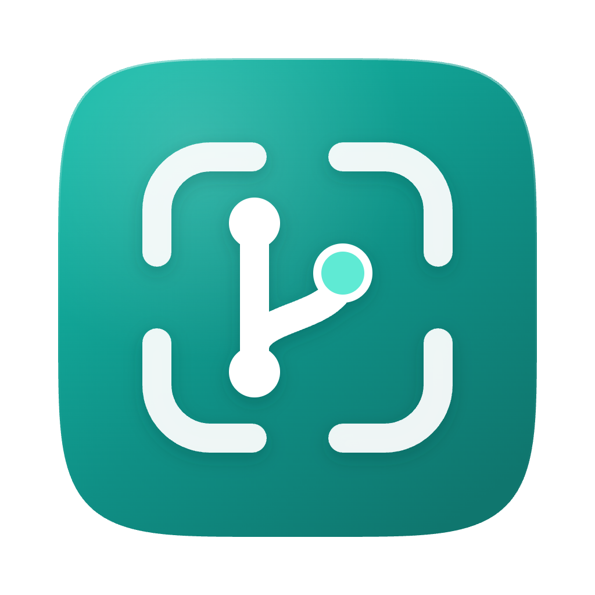
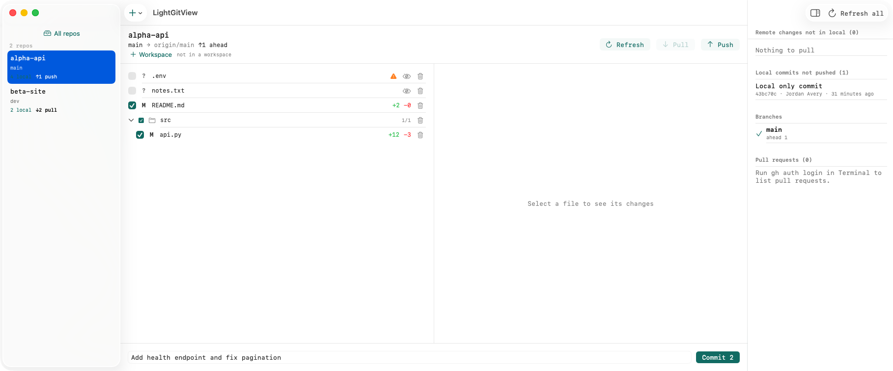
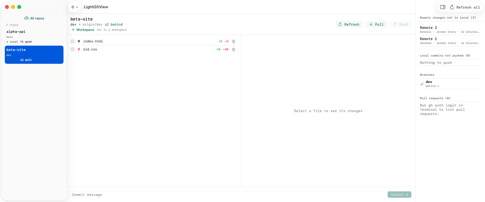

<p align="center"></p>

# LightGitView

**Every repo, one light window.** A small Mac app that shows all your git repos in one place, with what changed in each, and lets you commit, pull and push without opening a terminal.

  

<p align="center"></p>

## Walkthrough

[](https://youtu.be/D_sP2yl53xY)

A 2-minute tour, with captions: install, first launch, the repo list, commit, pull and push, discard and ignore, workspaces, the side panel and the secret warning. [Watch it on YouTube](https://youtu.be/D_sP2yl53xY), or [play the file here](docs/walkthrough.mp4). Chapters:

| Time | Chapter |
|---|---|
| 0:00 | What it is |
| 0:12 | Install |
| 0:28 | First launch |
| 0:40 | The repo list |
| 0:47 | Commit |
| 0:58 | Pull and push |
| 1:08 | Discard and ignore |
| 1:18 | Workspaces |
| 1:24 | The side panel |
| 1:36 | Secret warning |
| 1:42 | Recap |

## What it does

- Pick a folder and see every git repo in it, with its branch and how many changes, commits to push and commits to pull.
- Open a repo to see its changed files as a folder tree. Tick the files you want, write a message, commit.
- Pull, push and refresh from the app. Pull is fast-forward only, and push waits while you are behind.
- Discard a file or a whole folder (discarded new files go to the Trash, so you can get them back), or add it to `.gitignore`: this file, its folder, or every file with its extension.
- Right-click a repo and choose **Delete repo from disk**. The folder goes to the Trash, and the confirmation says how many uncommitted changes and unpushed commits it holds.
- Group repos into workspaces, or look at all of them at once.
- A side panel lists branches, commits you do not have yet, and open pull requests. Open a pull request to read its files and diff and its conversation, then comment, approve, request changes or close it (needs the GitHub CLI).
- It warns before you commit a file that looks like a secret, such as `.env`.

It is one small app (about a 1.3 MB download) that runs your own `git`. No account, no sign-in and no network use of its own.

## Install

Pick one.

**Homebrew**

```sh
brew tap drsammokhtari/tap
brew trust drsammokhtari/tap
brew install --cask lightgitview
```

Recent Homebrew versions refuse casks from a tap you have not trusted, so the `brew trust` line is needed once. Older versions do not have that command: skip it.

**Download**

Get [`downloads/LightGitView.zip`](downloads/LightGitView.zip) (or the latest [release](https://github.com/drsammokhtari/lightgitview/releases/latest)), unzip it and drag `LightGitView.app` to Applications.

**Build from source**

You need macOS 14 or later and the Xcode Command Line Tools (`xcode-select --install`).

```sh
git clone https://github.com/drsammokhtari/lightgitview.git
cd lightgitview
sh scripts/build-app.sh
open dist/LightGitView.app
```

## First launch

LightGitView is signed ad hoc and is not notarized by Apple, so macOS may say it cannot verify the developer when you open the downloaded zip. Right-click the app, choose **Open**, then **Open** again. You only do this once. The Homebrew install clears that flag for you.

The pull request list and review use the GitHub CLI (`gh`) when it is installed and signed in. The rest of the app needs only `git`.

## Quick start

1. Open LightGitView and choose the folder that holds your repos.
2. Click a repo in the list to see its changes.
3. Tick the files to include, type a message, and press Commit.
4. Use Pull and Push when the counts say there is something to sync.

To try it without touching your own repos, run `sh scripts/make-sample.sh ~/sample-workspace` and choose that folder.

## Update

```sh
brew upgrade --cask lightgitview
```

or download the new zip. See the [changelog](CHANGELOG.md) for what changed.

## Contributing

It is a Swift package with no dependencies. [`docs/DEVELOPING.md`](docs/DEVELOPING.md) says which file to edit for each kind of change, and `sh scripts/selftest.sh` checks it against a generated sample workspace. The mapped design for the app is in [`examples/sample-project`](examples/sample-project).

## Licence

[MIT](LICENSE).
